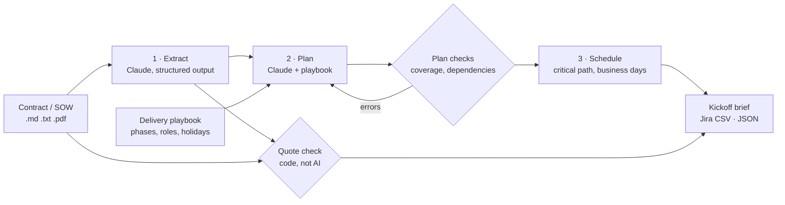

# Kickoff

**Turn a signed contract into a kickoff brief, a traceable project plan and Jira tickets.**

Between signature and kickoff, an implementation lead re-reads the statement of work, builds a plan, loads tickets, and tries to spot the clauses that will cause trouble later. Kickoff does the first pass in minutes, and every item it produces points back to the exact contract clause it came from, so a person can check it quickly instead of starting from a blank page.

It produces:

- **A kickoff brief** (Markdown): projected go-live against the contract date, contract risks ranked by severity with a recommended action for each, the chain of tasks that sets the go-live date, customer responsibilities, effort and cost by role with projected services margin, and a requirements traceability matrix.
- **A Jira import file** (CSV): epics and tasks with acceptance criteria, estimates, dates, phase and role labels, dependencies, and contract clause references.
- **Structured JSON** of everything above, for other tools.

**See a real run:** [examples/harbor-logistics/kickoff-brief.md](examples/harbor-logistics/kickoff-brief.md) is the brief Kickoff produced from the sample contract with `claude-opus-5-5`. It flagged 12 risks (4 high), including every problem planted in the contract, verified all 50 of its contract quotes word for word, and projected go-live 16 business days after the contract date, with a negative services margin on the fixed fee.

## How it works



1. **Extract.** Claude reads the contract and returns requirements (with acceptance criteria), customer dependencies, milestones, exclusions, payment terms and risks, as JSON validated against a schema. Each item carries the clause number and a verbatim quote.
2. **Verify quotes.** Code, not the model, matches every quote against the contract text. Quotes that don't appear word for word are flagged as approximate or not found, so invented or paraphrased support is visible.
3. **Plan.** Claude turns the extract into epics and tickets using the delivery playbook's phases and standard tasks. Code then checks the plan: every requirement and customer dependency has a ticket, dependencies exist and don't loop, phases are valid. If any check fails, the errors go back to Claude for one repair round.
4. **Schedule.** The critical path method puts every ticket on a business-day calendar (weekends and the playbook's holidays skipped), then compares projected go-live with the contract date and identifies the chain of tasks that drives it.

### Design decisions

- **Every claim is traceable.** A plan built from a misread contract is worse than no plan. Requiring verbatim quotes, and checking them with code, makes the AI's reading auditable.
- **The model generates; code checks.** Coverage, dependency loops, schedule maths and quote matching are deterministic and tested. The model is used only where judgement is needed: reading the contract, spotting risk, and designing the work.
- **Dates are a best case.** The schedule assumes people are free when each task can start. If the plan misses the contract date here, it will miss it in reality, and the brief says so.
- **Methodology lives in a file.** Phases, standard tasks, role rates and holidays are in a playbook TOML a services team can edit, not in code.

## Quick start

Requires Python 3.12+, [uv](https://docs.astral.sh/uv/) and an Anthropic API key.

```bash
uv sync
export ANTHROPIC_API_KEY=...        # or: ant auth login

uv run kickoff run data/sample/sow-harbor-logistics.md --out runs/harbor
```

This writes `runs/harbor/kickoff-brief.md`, `jira-import.csv`, `extract.json`, `plan.json` and `traceability.json`.

Other commands:

| Command | What it does |
|---|---|
| `kickoff extract CONTRACT --out DIR` | Only read the contract (one Claude call) |
| `kickoff plan CONTRACT --out DIR` | Plan from an existing `extract.json` |
| `kickoff report CONTRACT --out DIR` | Rebuild the brief and Jira file from saved JSON, with no Claude calls. Use this after editing `plan.json` by hand, or with `--start` to try a different start date |

Options: `--playbook FILE` (your own methodology), `--start YYYY-MM-DD` (defaults to the contract's effective date), `--model` (default `claude-opus-5-5`), `--effort` (default `high`).

### Importing into Jira

In Jira: **Settings › System › External system import › CSV**, choose `jira-import.csv`, and map `Issue Id` and `Parent Id` so tasks sit under their epics. Map both `Labels` columns to Labels, `Original Estimate` to Original Estimate, and the date columns to Start date and Due date.

## Sample contract

`data/sample/sow-harbor-logistics.md` is an invented statement of work between **Ledgerline** (accounts-payable automation software) and **Harbor Logistics Group**. It was written with problems a good implementation lead should catch, to test whether the extraction finds them:

- §2.4 promises integration with "any other systems as reasonably required", which contradicts the §6 exclusions.
- §2.6 commits to migrating "historical vendor data" with no volume or definition.
- The go-live date falls ten weeks after signing, across Thanksgiving, Christmas and New Year, for three entities in two countries.
- §4.5 makes bank approval for payments the customer's job, with no date, although payments are needed for go-live.
- §5.1 deems deliverables accepted after five business days of silence, and §8.1 ties 40% of the fee to "completion of UAT", which the customer controls.
- §2.5 depends on tolerance thresholds "agreed during discovery", so the configuration can't be finished until a decision the contract doesn't schedule.

No real company, customer or employer data is included.

## Tests

```bash
uv run pytest
```

The tests run offline with a fake Claude client and cover quote verification against the sample contract, plan checks and the repair loop, critical-path scheduling across holidays, the Jira export, the brief, and error handling.

## Limitations

- **No resource levelling.** The schedule assumes staff are available; it gives the earliest possible dates, not a staffing plan.
- **Estimates come from the model.** They are a starting point for the delivery team to adjust, not a quote.
- **Scanned PDFs need OCR first.** Word documents should be saved as PDF.
- **One contract at a time.** Amendments and change orders aren't merged yet.

## Roadmap

- [ ] Create epics and tasks directly through the Jira REST API, with issue links for dependencies
- [ ] Resource-aware scheduling from team capacity
- [ ] Map payment milestones to the tickets that trigger them, to forecast cash timing
- [ ] Change-order mode: compare an amendment with the original plan and show the impact on scope, dates and margin
- [ ] Web app: upload a contract, review the extract, push to Jira
